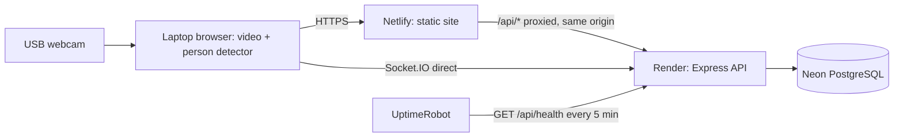

# Deployment Guide: Free-Tier Hosting with Browser Webcam Detection

Updated: 22 October 2026. This replaces the 14 October plan. It is written against the current repository (`jed-bot/group11`): Vue 3 + Vite frontend in `frontend/`, Express 5 + TypeORM + PostgreSQL + Socket.IO backend in `backend/`, Python YOLO service in `yolo-service/`.

Work through the phases in order. Each phase ends with a **Done when** check; do not start the next phase until it passes.

## Target architecture

All hosting is on free tiers that allow commercial use and do not expire. No Student Developer Pack credits are used.

| Part | Host | Free-tier limits to know |
| --- | --- | --- |
| Frontend (Vue build + detection model) | **Netlify** (free plan) | Monthly usage allowance; commercial use allowed. |
| Backend (Express + Socket.IO) | **Render** (free web service) | Sleeps after ~15 min without HTTP traffic, ~30-60 s cold start, 512 MB RAM, 750 instance-hours/month, files on disk are lost on every restart/deploy. |
| Database (PostgreSQL) | **Neon** (free plan) | 0.5 GB storage, monthly compute allowance, suspends when idle and resumes in about a second. Data is kept. |
| Keep-alive | **UptimeRobot** (free) | 5-minute checks. |

Free-tier terms change. Re-check each provider's pricing page in Phase 0 before committing.



Why these choices:

- **People are detected in the browser** on the laptop that opens the site. No Python host or GPU server is needed.
- **Netlify proxies `/api/*` to Render**, so the browser sees the API on the same origin as the site. The refresh-token cookie (`path: /api/auth`) then stays first-party, CORS is not involved for HTTP calls, and the existing frontend default `baseURL: '/api'` in `frontend/src/api/client.ts` works unchanged. Cloudflare Pages cannot proxy to an external host with a plain redirect rule, and Vercel's free plan is non-commercial, so Netlify is used.
- **Socket.IO connects directly to Render**, because Netlify's proxy does not carry WebSockets. This path needs CORS (Phase 1).
- **Neon instead of Render's own PostgreSQL**, because Render's free database expires after 30 days.

---

## Phase 0: Prepare accounts and secure the repository

1. Create free accounts on Netlify, Render, Neon and UptimeRobot, each signed in with GitHub. Confirm the current free-tier limits listed above.
2. Pick one region for both Render and Neon (for example Singapore / AWS `ap-southeast-1`) to keep database latency low.
3. Stop tracking the committed environment files. These are currently in git: `backend/.env`, `frontend/.env`, `yolo-service/.env`.

   ```bash
   git rm --cached backend/.env frontend/.env yolo-service/.env
   ```

   Add to `.gitignore`:

   ```gitignore
   .env
   .env.*
   !.env.example
   ```

4. Treat every value that was in those files as leaked (they remain in git history). Do not reuse any of them in production: generate new JWT secrets, a new admin password, and new database credentials in later phases.
5. Remove leftover secrets and real values from `ENV.md`, `START.md`, `ARCHITECTURE.md` and the `.env.example` files.
6. Create a working branch, for example `deploy/free-tier`.
7. Record a local baseline from a clean install:

   ```bash
   cd backend && npm ci && npm run build && npm test
   cd ../frontend && npm ci && npm run build
   ```

   The frontend build currently needs `--max-old-space-size=8192` (already in `package.json`). Note how long it takes and how much memory it uses; Phase 6 depends on it.

**Done when:** `git ls-files | grep .env` lists only `.env.example` files, and both builds pass locally.

---

## Phase 1: Make the backend production-ready

All changes are in `backend/`.

| File | Change |
| --- | --- |
| `src/app.ts` | Add `app.set('trust proxy', <hops>)` before the rate limiter, driven by a new `TRUST_PROXY_HOPS` env value (default `0`). Requests pass through Netlify and Render, so start with `2` and confirm in logs that `req.ip` is the visitor's address, not a proxy's. Without this, `express-rate-limit` treats all users as one IP. |
| `src/config/env.ts` | Add `TRUST_PROXY_HOPS` to the schema. |
| `src/services/yoloLive.instance.ts` | The Socket.IO server uses only the first CORS origin (`config.corsOrigins[0]`). Pass the full `config.corsOrigins` list. |
| `src/services/socketIoBroadcaster.ts` | Require a valid access token in the Socket.IO handshake (`auth.token`) and check roles before accepting control commands. Read-only state broadcasts may remain open if the client agrees. |
| `src/routes/yolo.routes.ts` | `POST /yolo/toggle` requires an admin login. `POST /yolo/detection` (Python → API) requires the `X-Ingest-Key` header to match `YOLO_INGEST_KEY` (new `src/middleware/requireIngestKey.ts`); with no key set it is open only when `NODE_ENV=development`. `yolo-service/app.py` sends the header when its own `YOLO_INGEST_KEY` is set. Keep `GET /health` public; it is the keep-alive target. |
| `trafficSignal`, `trafficLightAudit`, `cameraRecording` services | Imported `signalIo` from `server.ts`, which started the whole server (and database) on import. Use `getSignalIo()` from `yoloLive.instance.ts` instead. |
| `vitest.config.ts` (new) | Tests get fixed dummy env values, so they never read `backend/.env` or need a database. |
| `src/config/ormconfig.ts` | Replace `ssl: { rejectUnauthorized: false }` with `ssl: { rejectUnauthorized: true }`. Neon uses publicly trusted certificates, so verification works without extra files. |
| `package.json` | Add production scripts that run against the compiled output (the existing `db:migrate` uses a CommonJS runner with an ESM project):<br>`"db:migrate:prod": "typeorm migration:run -d dist/config/ormconfig.js"`<br>`"db:seed:prod": "node dist/db/seed.js"` |
| `src/services/trafficSignal.service.test.ts` | Found in Phase 0: the suite failed to load because of the `server.ts` import above. Once loading, two assertions were outdated (RED re-sends every second with Arduino countdown timers); they now compare light changes only. |
| `frontend/src/composables/useLiveSystemState.ts` | Sends the access token as Socket.IO `auth`, and on rejection renews the session and reconnects. |
| `package.json` | Pin the Node version Render uses: change `engines.node` to `"22.x"` (or set `NODE_VERSION=22` on Render). |

Cloud-only behaviour (set through environment values in Phase 5, no code change needed):

- `SIGNAL_TRANSPORT=log` and `YOLO_LIVE_ARDUINO_TRANSPORT=log`. A cloud server cannot open the laptop's `COM3` port.
- `DETECTION_MOCK=true`. Uploaded-video detection depends on the Python service, which is not hosted.
- Uploads and recordings written to `UPLOAD_DIR` are lost when Render restarts. Hide or disable the upload and server-recording features in production until durable storage is added (see Phase 9).

**Done when:** `npm run build && npm test` pass, and a local run with `NODE_ENV=production` rejects unauthenticated calls to the secured routes and Socket.IO.

**Status (22 October 2026): done.** Backend typecheck, build and 29/29 tests pass; frontend typecheck passes. A production-mode smoke test (no database) passed 12/12: public `/api/health`, 401 for toggle and ingest without credentials, ingest key accepted, Socket.IO CORS for every listed origin and rejection of unknown origins, Socket.IO rejects missing/invalid tokens. Not yet exercised: login and valid-token socket connections against a real database (covered in Phase 4/8). Known leftover: `POST /api/yolo/detection` does not validate its body (a malformed payload returns 500); the route is key-protected and is retired in Phase 3.

---

## Phase 2: Build browser webcam detection

This replaces the Python camera stream for live monitoring. The browser opens the webcam, runs the person detector, and shows boxes and the current count.

Runtime and model:

- Install a pinned version of `@mediapipe/tasks-vision` in `frontend/`.
- Use the Object Detector in `VIDEO` mode with an EfficientDet-Lite0 model (COCO classes, includes `person`). Place the `.tflite` file in `frontend/public/models/` so it is deployed with the site, and load it from `` `${import.meta.env.BASE_URL}models/<file>.tflite` ``.
- Serve the WebAssembly files from the same pinned package version (copy them into `frontend/public/` or load from a pinned CDN URL). Do not mix versions.
- If the custom YOLO weights are required for accuracy, export them to ONNX and run them with ONNX Runtime Web instead. A `.pt` file cannot run in the browser.

Behaviour:

- A **Start monitoring** button calls `navigator.mediaDevices.getUserMedia({ video: { deviceId }, audio: false })`. This only works over HTTPS (Netlify provides it) or on `localhost`.
- After permission, list cameras with `enumerateDevices()` and let the user pick the external webcam.
- Run detection about 5-10 times per second, never with overlapping jobs. Keep only `person` results above a configurable confidence threshold.
- Draw boxes on a canvas sized to the displayed video, accounting for cropping and mirroring.
- Show distinct states: permission needed, loading model, monitoring, paused, error. A failed or missing detection must never display as a count of zero.
- Stop all tracks and the detection loop when switching cameras, leaving the page, or pressing Stop.
- The count means **people visible in the current frame**. Unique visitors or crossing counts are a separate feature.

Files (as built; the live dashboard is `DashboardView` → `SafetyCamera`, so the unused `MultiCameraGrid`, `LiveStage`, `LiveDetectionPanel`, `BoundingBoxOverlay` and `SystemHealthRail` are left for removal in Phase 3):

| File | Change |
| --- | --- |
| `frontend/package.json` | `@mediapipe/tasks-vision` pinned to `1.0.1`; `predev`/`prebuild` copy its WebAssembly runtime; `vitest` and `npm test` added. |
| `frontend/public/models/efficientdet_lite0_fp16.tflite` | EfficientDet-Lite0 (float16, COCO) from Google's MediaPipe model storage, served from the site. |
| New `frontend/scripts/copy-mediapipe-wasm.mjs` | Copies the runtime into `public/mediapipe/wasm/` (git-ignored) so it always matches the npm version. |
| New `frontend/src/utils/personDetector.ts` | Loads the detector once (GPU, falling back to CPU), keeps confident `person` results, returns boxes normalised to the frame. |
| New `frontend/src/utils/detectionOverlay.ts` | Maps boxes onto the letterboxed (`object-fit: contain`) video and draws labelled boxes on a high-DPI canvas. |
| New `frontend/src/composables/useWebcamDetection.ts` | Permission, camera list and selection (remembered), track lifecycle, detection loop (~150 ms, no overlap), count, stall/unplug detection, pause while the tab is hidden, operator-facing error messages. Count is `null` whenever detection is not running. |
| `frontend/src/components/dashboard/SafetyCamera.vue` | `<video>` + overlay canvas, camera selector, Start/Stop/Try again, a message for every state. |
| `frontend/src/views/DashboardView.vue` | Count, trend chart and activity log use the local detection instead of the backend's YOLO messages. |

**Done when:** on `npm run dev` at `http://localhost:5173`, the external webcam opens after permission and the count is correct for zero, one, and several people, with boxes aligned.

**Status (22 October 2026): done, pending a check with the real USB webcam.** Frontend typecheck, production build and 16/16 unit tests pass. A headless-Chrome end-to-end test (fake webcam fed from video files, two full passes, all checks passed) confirmed: camera + model ready within seconds; real pedestrians (OpenCV `vtest.avi`) counted 2-5 with aligned boxes; empty scene counted 0 with no boxes; the project's scale-model figure detected in roughly 55-80% of samples at 77% confidence; Stop releases the camera and clears the count and boxes; unplug and permission denial show recovery messages and never show a number; about 4-5 detections per second in headless Chrome. Known limits: people walking close together can merge into one box (undercount in groups), and the small model figure flickers between 0 and 1. If that matters, try a lower `minScore` or the larger EfficientDet-Lite2 model and re-measure on the real laptop.

---

## Phase 3: Retire the Python live path

1. `frontend/src/api/yolo.ts`: remove calls to the Python service (`VITE_YOLO_API_URL`, default `http://localhost:8000`).
2. Remove `VITE_YOLO_VIDEO_URL` and `VITE_YOLO_API_URL` from `frontend/.env.example`.
3. `frontend/src/composables/useLiveSystemState.ts`: keep Socket.IO for shared state (signal mode, timers), but local counting must not depend on it. Pass the access token in the Socket.IO `auth` option to match Phase 1.
4. Optional, if other dashboards should see the count: send a summary (count, timestamp, session ID) to an authenticated API route on change or at most once per second. Store summaries, not frames. Mark data stale when updates stop.
5. Backend: remove or secure the Python ingestion route (Phase 1). `backend/src/services/cameraRecording.service.ts` records from a localhost MJPEG stream and cannot work in the cloud; disable it in production.
6. Leave `yolo-service/` and `yolobackend/` in the repository for now. Uploaded-video detection still uses them. Decide on that feature before deleting anything.

**Done when:** the dashboard runs locally with `yolo-service` stopped and shows no Python-related errors.

As built:

- **The browser now drives the traffic lights.** The backend's live cycle (person seen for the threshold time → caution → red with countdown) was fed only by the Python service. `frontend/src/composables/useDetectionReporter.ts` sends the browser's count to the new `POST /api/live/detection` (login required, validated, same rate-limit bucket as the Python ingest) on every change (at most 4/s) and once a second while monitoring. Nothing is sent when detection is not running.
- **Stale data is cleared.** `markYoloOffline()` existed but was never called, so the last state (possibly "pedestrian detected") stayed forever. It now runs every second: after 5 s without reports the feed is marked offline and pedestrian state reset, so old detections can never start a cycle. A cycle already running finishes on its own timers.
- **Monitoring is app-wide.** `useWebcamDetection` lives in `AppLayout` (with its own hidden inference `<video>`), so it keeps running on Settings, Diagnostics and other pages. Logout stops it.
- **Model warm-up.** The first GPU detection can block the page for seconds; it now runs during "Loading the detection model…", so "Live" means ready.
- **Diagnostics** shows the browser camera, detection speed and a "Server link" panel (last report, whether the server sees the feed).
- Removed: `api/yolo.ts`, `MultiCameraGrid`, `LiveStage`, `LiveDetectionPanel`, `BoundingBoxOverlay`, `SystemHealthRail`, and `VITE_YOLO_*` from `frontend/.env.example`. `POST /api/yolo/detection` now validates its body (422 instead of 500). Server recording returns a clear error in production.

**Status (23 October 2026): done.** Backend 35/35 and frontend 21/21 tests, typecheck and production build pass. Full-stack test against a temporary PostgreSQL set up with `db:migrate:prod` + `db:seed:prod` (all 3 migrations, admin created) and the backend in production mode, all checks passed: login; reports accepted (204); server sees the feed and the count; caution started 5.6 s after Live (5 s threshold), dashboard warning light via authenticated Socket.IO; red with countdown; reports continue on Diagnostics; Stop → no reports, server offline and pedestrians cleared within 5 s; logout releases the camera. Phase 2 camera tests re-run with no regressions.

Known issue found (pre-existing, not changed): the live cycle never sets `pedState`, so the dashboard's pedestrian signal stays RED ("Pedestrians Wait") during the red phase instead of showing WALK. Limitation: if two logged-in dashboards monitor at once, both feed the same traffic-light cycle; run monitoring on one computer only.

---

## Phase 4: Create the database on Neon

1. Neon → **New project**, PostgreSQL 16 or newer, region from Phase 0.
2. Copy the **pooled** connection string. It looks like `postgres://<user>:<password>@<host>-pooler.<region>.aws.neon.tech/<db>?sslmode=require`.
3. Run migrations and the admin seed **once, from your laptop**, against Neon (Render's free tier has no pre-deploy command). In a terminal in `backend/`, set the variables for that session only, never in a committed file:

   ```bash
   export NODE_ENV=production
   export DATABASE_URL='<neon connection string>'
   export DB_SSL=true
   export JWT_ACCESS_SECRET=$(openssl rand -hex 48)
   export JWT_REFRESH_SECRET=$(openssl rand -hex 48)
   export ADMIN_EMAIL='<real admin email>'
   export ADMIN_PASSWORD='<new strong password>'

   npm run build
   npm run db:migrate:prod
   npm run db:seed:prod
   ```

   The JWT values here only satisfy config validation; Render gets its own in Phase 5. On Windows PowerShell use `$env:NAME = 'value'` instead of `export`.
4. The seed resets the administrator's credentials. Never run it on every start or as part of the build.
5. Re-run `npm run db:migrate:prod` the same way whenever a new migration is added.

**Done when:** Neon's table view shows the tables from `backend/src/migrations/` plus the `migrations` table, and the admin row exists.

Notes from running it: copy the plain `postgresql://...` string (Connect → "Connection string"), not the `psql '...'` command or the `.env` line; otherwise the host is parsed wrongly (`ENOTFOUND base`). `pg` prints a harmless notice about `sslmode=require`; use `sslmode=verify-full` in the URL to make full certificate checking explicit and silence it.

**Status (23 October 2026): done.** Migrations ran and the administrator account was created on Neon.

---

## Phase 5: Deploy the backend on Render

Render → **New → Web Service** → connect `jed-bot/group11`.

| Setting | Value |
| --- | --- |
| Branch | `main` (after merging the work branch) |
| Root directory | `backend` |
| Runtime | Node |
| Build command | `npm ci --include=dev && npm run build` |
| Start command | `node dist/server.js` |
| Instance type | Free |
| Health check path | `/api/health` (not `/health`: that queries the database, and Render's frequent checks would keep Neon from ever suspending) |

`--include=dev` is needed because TypeScript is a dev dependency and Render sets `NODE_ENV=production` during the build.

Environment variables (Render → Environment):

| Name | Value |
| --- | --- |
| `NODE_ENV` | `production` |
| `NODE_VERSION` | `22` |
| `DATABASE_URL` | Neon **pooled** connection string (host contains `-pooler`), with `sslmode=verify-full` |
| `DB_SSL` | `true` |
| `JWT_ACCESS_SECRET` | new `openssl rand -hex 48` |
| `JWT_REFRESH_SECRET` | another, different `openssl rand -hex 48` |
| `CORS_ORIGIN` | `https://<site>.netlify.app` (add the custom domain later, comma-separated) |
| `COOKIE_SECURE` | `true` |
| `COOKIE_SAMESITE` | `lax` |
| `TRUST_PROXY_HOPS` | `2` (verify per Phase 1) |
| `SIGNAL_TRANSPORT` | `log` |
| `YOLO_LIVE_ARDUINO_TRANSPORT` | `log` |
| `DETECTION_MOCK` | `true` |
| `LOG_LEVEL` | `info` |

Do not set `PORT`; Render provides it and `env.ts` reads it. `HOST` defaults to `0.0.0.0`, which Render needs. Do not set `ADMIN_PASSWORD` on Render.

**Done when:** `https://<service>.onrender.com/health` returns `{"success":true,"status":"ok","database":"connected"}`.

---

## Phase 6: Deploy the frontend on Netlify

1. Add `frontend/netlify.toml`:

   ```toml
   [build]
     command = "npm run build"
     publish = "dist"

   [build.environment]
     NODE_VERSION = "22"

   # API: proxied so the refresh cookie stays first-party. Must come before the SPA rule.
   [[redirects]]
     from = "/api/*"
     to = "https://<service>.onrender.com/api/:splat"
     status = 200
     force = true

   # SPA fallback so refreshing /dashboard etc. works with createWebHistory.
   [[redirects]]
     from = "/*"
     to = "/index.html"
     status = 200
   ```

   With this, the router can keep `createWebHistory()` and Vite can keep the default `base: '/'`. No hash routing is needed.
2. Netlify → **Add new site → Import from Git** → `jed-bot/group11`. Base directory: `frontend`. Netlify reads the rest from `netlify.toml`.
3. Environment variables (Netlify → Site configuration → Environment variables):

   | Name | Value |
   | --- | --- |
   | `VITE_WS_URL` | `https://<service>.onrender.com` |

   Leave `VITE_API_URL` unset so API calls use `/api` and go through the proxy. Every `VITE_` value is visible in the published JavaScript; never put secrets in them.
4. Build memory: the build uses an 8 GB heap setting. If Netlify's build runs out of memory, build locally and upload the result instead:

   ```bash
   cd frontend
   npm run build
   npx netlify-cli deploy --prod --dir=dist
   ```

   (Run `npx netlify-cli link` once first.) The proxy and SPA rules still apply because `netlify.toml` is read from the linked site; if not, copy them into `frontend/public/_redirects`.
5. Copy the final site URL into Render's `CORS_ORIGIN` and redeploy the backend.

**Done when:** the site loads at `https://<site>.netlify.app`, login works, refreshing any page stays logged in, and the browser's network tab shows `/api/...` calls on the Netlify origin.

---

## Phase 7: Keep the backend awake

1. UptimeRobot → **New monitor**, type HTTP(S), URL `https://<service>.onrender.com/api/health`, interval 5 minutes.
2. Use `/api/health`, not `/health`. `/api/health` does not touch the database, so Neon can still suspend when nobody is using the site and its free compute allowance lasts the month. `/health` queries the database and would keep Neon running constantly.
3. One always-on service uses about 730 of Render's 750 free hours per month. Do not run a second free Render service on the same account.
4. Netlify's proxy waits only about 26 seconds for the backend. If the backend was asleep anyway (for example after a deploy), the first API call can fail; the next one succeeds. Show a "Connecting to server…" retry state rather than an error.

**Done when:** after an hour without using the site, the first page load logs in without a cold-start delay.

---

## Phase 8: Production acceptance checks

Run these on the deployed URL, on the laptop and webcam that will actually be used.

Camera and detection:

- [ ] External webcam opens after permission; denying permission shows a recovery message.
- [ ] Unplugging the webcam, or using a camera already in use by another app, shows an error state, not a zero count.
- [ ] Switching cameras and leaving the page stop the old camera light and the detection loop.
- [ ] Count is correct for zero, one and several people; boxes line up with people.
- [ ] Detection speed is acceptable on this laptop (target 5+ detections per second).
- [ ] Model and WebAssembly files load from the Netlify URL (no 404s in the network tab).
- [ ] Counting keeps working when the backend is unreachable.

Accounts and server:

- [ ] Admin login, logout, and staying logged in after a page refresh and after 15+ minutes (access token renewal).
- [ ] Staff management and audit logs work for admins and are blocked for non-admins.
- [ ] Socket.IO connects (no CORS errors in the console) and rejects connections without a token.
- [ ] Unauthenticated `POST /api/yolo/toggle` is rejected.
- [ ] Rate limiting applies per visitor, not to everyone at once.
- [ ] Backend restart (Render → Manual Deploy) loses no database data.

Operations:

- [ ] Laptop sleep and browser tab suspension are documented for the client: monitoring stops when the laptop sleeps or the tab is closed.
- [ ] No secrets in the repository or in the built JavaScript.

---

## Phase 9: Optional features (only when needed)

These are not required for the first release. Each is its own piece of work.

| Feature | What it needs |
| --- | --- |
| Saved snapshots / recordings | Capture from a canvas (snapshots) or `MediaRecorder` on a canvas stream that includes the overlay. Offer as downloads first (free). For cloud storage, upload to Supabase Storage free tier (1 GB) or Cloudflare R2 free tier, and store only the file key in PostgreSQL. Never store files on Render's disk. |
| Uploaded-video detection | Needs the Python service hosted somewhere with enough memory, which no reliable free tier provides. Keep it local-only or drop it. |
| Physical traffic lights (Arduino) | A hosted server cannot reach `COM3`. Run a small authenticated local bridge on the laptop (the existing `backend/src/services/arduinoSerial.shared.ts` logic) or use the browser Web Serial API (Chrome/Edge only). Define what the lights do when the page closes or detections go stale. |
| Viewing the camera from another device | Needs a WebRTC media-sharing implementation. Sharing counts through the API does not share video. |
| Custom domain | Add it in Netlify (free HTTPS), then add it to `CORS_ORIGIN` on Render. |

---

## Phase 10: Handover and maintenance

1. Update `ARCHITECTURE.md`, `START.md` and `ENV.md` to match the deployed setup (no Python for live monitoring, Neon, Render, Netlify).
2. Give the client a short operating note: open the site, press Start monitoring, allow the camera, keep the laptop awake and the tab open.
3. Store all production credentials (Neon, Render, Netlify, admin) in a password manager, not in the repository or chat.
4. Database backups: Neon's free plan keeps only a short restore window. Take a monthly `pg_dump` of the Neon database and keep it off the repository.
5. Watch monthly usage on Render (instance hours), Neon (compute and storage) and Netlify (bandwidth/credits).
6. Upgrade path if the client pays later, cheapest first: Render Starter instance (no sleep, removes the keep-alive), then Neon paid plan if storage or compute runs out. The code does not change.

---

## Quick reference

| Item | Where |
| --- | --- |
| Frontend build | `frontend/` → `npm run build` → `dist/` |
| Backend build / start | `backend/` → `npm run build` → `node dist/server.js` |
| Migrations | `backend/` → `npm run db:migrate:prod` (from your laptop, with `DATABASE_URL` set) |
| Admin seed (once) | `backend/` → `npm run db:seed:prod` |
| Health (with database) | `https://<service>.onrender.com/health` |
| Health (keep-alive) | `https://<service>.onrender.com/api/health` |
| Netlify config | `frontend/netlify.toml` |
| Secrets | Render and Netlify environment settings only |
